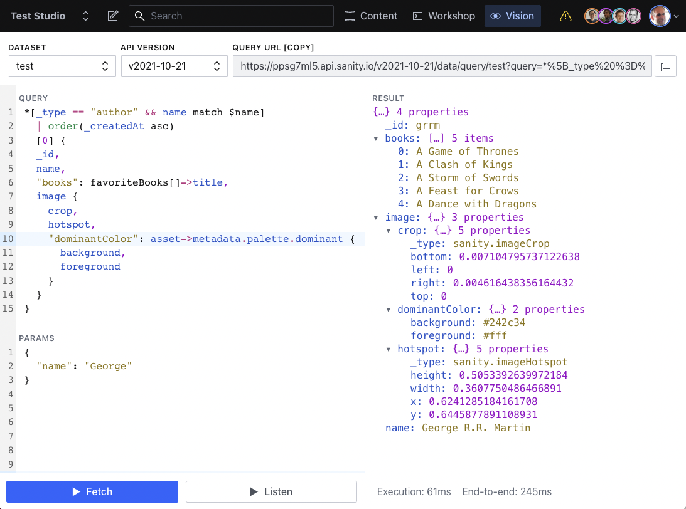

# sanity-vision

Vision is a plugin for Sanity Studio for testing GROQ queries. It features:

- GROQ syntax highlighting so that the query is easier to read
- Parsed response that's more convenient to navigate and explore
- Switching between datasets
- Listening for real-time updates



## Installation

`npm install --save-exact @sanity/vision`

### Configuring

```ts
import {visionTool} from '@sanity/vision'
// `sanity.config.ts` / `sanity.config.js`:
import {defineConfig} from 'sanity'

export default defineConfig({
  // ...
  plugins: [
    visionTool({
      // Note: These are both optional
      defaultApiVersion: 'v2021-10-21',
      defaultDataset: 'some-dataset',
    }),
  ],
})
```

### Only enabling it for development

If you only want the Vision tool available in development (e.g., not in deployed studios), you can import and use the `isDev` constant from the `sanity` package:

```ts
import {visionTool} from '@sanity/vision'
// `sanity.config.ts` / `sanity.config.js`:
import {defineConfig, isDev} from 'sanity'

const devOnlyPlugins = [visionTool()]

export default defineConfig({
  // ...
  plugins: [
    // ... your other plugins here ...
    ...(isDev ? devOnlyPlugins : []),
  ],
})
```

### Only enabling it for administrators

If you only want the Vision tool available to administrators, you can use the [Tool API](https://www.sanity.io/docs/studio-tools) to filter out the tool based on role:

```ts
import {visionTool} from '@sanity/vision'
// `sanity.config.ts` / `sanity.config.js`:
import {defineConfig} from 'sanity'

export default defineConfig({
  // ... name, title, projectId, dataset, etc.
  plugins: [
    // ... your other plugins here ...
    visionTool(),
  ],
  tools: (prev, {currentUser}) => {
    const isAdmin = currentUser?.roles.some((role) => role.name === 'administrator')

    // If the user has the administrator role, return all tools.
    // If the user does not have the administrator role, filter out the vision tool.
    return isAdmin ? prev : prev.filter((tool) => tool.name !== 'vision')
  },
})
```

## Beta: the redesigned Vision

Vision ships an opt-in redesign behind the `beta.redesign` option. It is off by default. When enabled, the classic tool shows a dismissible toast inviting users to try the redesign; users who accept get the redesigned tool, remembered per project in their browser, and can switch back at any time from its sidebar or settings (or by clearing its storage).

```ts
import {visionTool} from '@sanity/vision'
// `sanity.config.ts` / `sanity.config.js`:
import {defineConfig} from 'sanity'

export default defineConfig({
  // ...
  plugins: [
    visionTool({
      beta: {redesign: {enabled: true}},
    }),
  ],
})
```

What is different in the redesign:

- **Query tabs**, each with its own query, params and options. The options follow the studio by default: the dataset follows the workspace's until you pin one, the **Global** perspective runs the query against the navbar's perspective (the pinned release, drafts or published; a tab can also pick `raw`, `published`, `drafts` or scheduled drafts of its own), and the **Variant** option sends the navbar's variant or none; the API version and the content source map are set per tab. Drag a tab (or press Shift with an arrow key) to reorder them, double-click a title (or press F2) to rename it; tabs and their order are persisted per project in `localStorage`.
- **Query, Params and Options stacked** in the request column, all visible at once above a bottom action bar (Live fetch, Fetch and a show-more menu, like structure document panels, with the API version the requests go out with on its other end; pressing it opens the field that changes it): the editor takes whatever the two panels leave over, Params grow with their JSON (drag their top edge for another height, double-click it to fit the content again) and Options are as tall as their fields. Both panels collapse to a header, remembered per project. The Params panel's experimental **Form** view lists every `$param` the query uses with a field for it, typed from how the query uses it and, like `sanity typegen`, from the workspace schema: `_type == $type` suggests the document types, a field with an options list suggests its values, slice bounds take whole numbers, `references($id)` a document ID. Values that do not fit are still sent, with a note, so you can test them.
- **Generate query**: the sparkles button over the query editor opens a field above it that writes a query from a description ("the 10 most recent authors, ordered by last name and then first name"); Enter generates, Escape closes. [Agent Actions](https://www.sanity.io/docs/agent-actions/introduction) (`client.agent.action.prompt`, which needs API version `vX` and Agent Actions on the project) get the description, the names and fields of the document types it mentions and a GROQ primer; each attempt is compiled on the Content Lake with the active tab's options without running it (`select(false => …)`), and a rejected one is retried with the API's error, up to three times. The query goes into the tab while its query is empty, otherwise into a new tab with the same options, and runs there; when every attempt is rejected, the last one can still be opened to fix by hand.
- **The active query in the address bar**: once typing settles, the tool's URL holds the active tab's request (`?vision[url]=…`, the query URL the Response panel shows, replacing the history entry rather than adding one), so it can be bookmarked or shared. Opening such a link selects a tab that already shows the request, or opens one for it, read the way a pasted query URL is.
- **A collapsible sidebar** with your saved queries, the queries shared in the dataset, the keyboard shortcuts and the settings. Saved queries are shared with the classic tool.
- **Live fetch**: an alternative to **Fetch** that fetches the query and then fetches it again whenever the documents it depends on change (the response's `syncTags` are matched against the Live Content API), until **Stop live**. While a fetch runs, Fetch reads **Stop** and stops that fetch only. Fetch still fetches on demand meanwhile, for results no document change touches, like `now()`. The History panel records every fetch and why it happened, and whether its result changed since the previous one: expand **Changes** for a line diff of the two results, rendered with [`@pierre/diffs`](https://diffs.com) (loaded only when a diff is expanded). When the query, the params or the request URL (API host and version, dataset, perspective and variant) changed too, they are diffed above the result, the query laid out by `groq-format` with every attribute, condition and argument on a line of its own so a change reads like one in the JSON; turning the Content Source Map on or off is left out, since it does not change the result. Besides the result on screen, the ten most recent results are kept for this, each up to 1 MB as JSON. Fields that change with every revision (`_rev`, `_updatedAt` and `_system.base.rev` by default, matched at any depth) are left out of the diffs, so an entry where only they changed says so; the list is in the settings, and each diff can show them.
- **The result as a tree or as JSON**: the tree has a copy button on each property's row (text is copied as it is, everything else as indented JSON), the JSON view is a read-only editor to select any part of the result from, with foldable objects and arrays, and Copy result next to the switch copies all of it. The choice is remembered per project.
- **Explain**: a panel next to History that shows the query plan, how the Content Lake runs the query (the query endpoint's `explain` option, which `@sanity/client`'s `fetch` cannot send, so the query URL is requested directly), and on request has Agent Actions explain the query and its plan in plain words. Both belong to the query they were made for and clear when it changes.
- **Response details**: execution and end-to-end time, payload size, sync tags, the query URL and the content source map when requested.
- **Exports**: the query as `curl`, `@sanity/client` and `next-sanity` snippets; the result as JSON or CSV, and as TypeScript types or a Zod schema inferred from the workspace schema (falling back to the fetched result).
- **Prettify and lint** from [sanity-labs/sanity-lint](https://github.com/sanity-labs/sanity-lint), through its `@sanity-labs/groq-wasm` build: Prettify formats the query with `groq-format`, wrapping lines at the query editor's current width so the result needs no sideways scrolling, and the editor underlines what the `groq-lint` rules find (joins in filters, comparisons that cannot use an index, deep pagination, ...). Hover a finding for its explanation, press F8 to jump to the next one, or open the Lint panel next to the response, which lists every finding and selects one in the editor when picked. Pasting a query URL from the network tab loads it into the active tab.

The redesign is in beta: its look and feature set may still change.

## License

MIT-licensed. See LICENSE.
